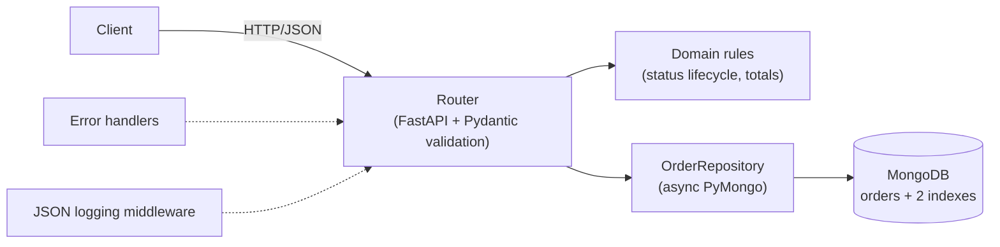

# Atlas API

[](https://github.com/Koray-Ozt/Atlas_Api/actions/workflows/ci.yml)

A small orders REST API built with **FastAPI**, **MongoDB** and **Pydantic**. It is a deliberately compact
codebase (~400 lines of application code) that shows how I structure a Python backend: validated input,
layered code, meaningful indexes, consistent errors, structured logs, real integration tests and a
one-command setup.

```bash
docker compose up --build        # API on http://localhost:8000, interactive docs on /docs
```

## What it demonstrates

| Area | Where |
|---|---|
| Typed, layered design (router → repository, pure domain rules) | `app/orders/` |
| Input validation and RESTful semantics (201 + `Location`, 204, 409, 422) | `schemas.py`, `router.py` |
| Business rules as pure functions (status lifecycle, totals in integer cents) | `domain.py` |
| MongoDB modelling and compound indexes that match the query shapes | `app/db.py` |
| Filtering and stable pagination | `repository.py` |
| Centralised error handling with one JSON error shape | `app/errors.py` |
| Structured JSON logs with a per-request `request_id` | `app/logging.py`, `app/main.py` |
| Unit tests plus integration tests against a real MongoDB | `tests/` |
| Reproducible environment and CI | `Dockerfile`, `docker-compose.yml`, `.github/workflows/ci.yml` |
| Measured index impact | `scripts/benchmark.py` |

## Architecture



```
app/
  main.py            app factory, lifespan (client + indexes), request logging middleware, /health
  config.py          settings from ATLAS_* env vars
  db.py              index definitions
  errors.py          exception types + handlers
  logging.py         JSON formatter, request-id context
  orders/
    schemas.py       request/response/query models
    domain.py        status transitions, order total
    repository.py    all MongoDB access and filter building
    router.py        HTTP endpoints
```

## API

Interactive documentation is served at `/docs` (Swagger UI) and `/openapi.json`.

| Method | Path | Description | Success | Errors |
|---|---|---|---|---|
| `POST` | `/orders` | Create an order (status starts as `pending`, total is computed server-side) | 201 | 422 |
| `GET` | `/orders` | List orders: filters + pagination, newest first | 200 | 422 |
| `GET` | `/orders/{id}` | Get one order | 200 | 404, 422 |
| `PATCH` | `/orders/{id}` | Change `status` and/or `items` | 200 | 404, 409, 422 |
| `DELETE` | `/orders/{id}` | Delete an order | 204 | 404, 422 |
| `GET` | `/health` | Liveness + database ping | 200 | 503 |

**List query parameters:** `status` (`pending|paid|shipped|cancelled`), `customer_email`, `created_from`,
`created_to` (ISO 8601), `min_total_cents`, `limit` (1–100, default 20), `offset` (default 0).

**Status lifecycle:** `pending → paid → shipped`; `pending` and `paid` can also go to `cancelled`.
Anything else is a `409`. Items can only be edited while the order is `pending`.

### Examples

Create an order:

```bash
curl -s -X POST localhost:8000/orders -H 'Content-Type: application/json' -d '{
  "customer_email": "ada@example.com",
  "items": [{"sku": "KEYBOARD-01", "quantity": 2, "unit_price_cents": 4500}]
}'
```
```json
{
  "id": "6728a1f3c5d1e2a4b8f09c11",
  "customer_email": "ada@example.com",
  "items": [{"sku": "KEYBOARD-01", "quantity": 2, "unit_price_cents": 4500}],
  "status": "pending",
  "total_cents": 9000,
  "created_at": "2026-11-03T00:41:07.512000Z",
  "updated_at": "2026-11-03T00:41:07.512000Z"
}
```

List with filters and pagination:

```bash
curl -s 'localhost:8000/orders?status=pending&min_total_cents=5000&limit=10&offset=0'
```
```json
{ "items": [ { "id": "6728a1f3c5d1e2a4b8f09c11", "...": "..." } ], "total": 1, "limit": 10, "offset": 0 }
```

Move an order through its lifecycle, and an invalid transition:

```bash
curl -s -X PATCH localhost:8000/orders/6728a1f3c5d1e2a4b8f09c11 \
  -H 'Content-Type: application/json' -d '{"status": "shipped"}'
```
```json
{ "error": { "code": "invalid_status_transition", "message": "Cannot change status from 'pending' to 'shipped'" } }
```

Validation errors list every offending field:

```json
{
  "error": {
    "code": "validation_error",
    "message": "Request validation failed",
    "details": [{ "field": "body.customer_email", "message": "String should match pattern '^[^@\\s]+@[^@\\s]+\\.[^@\\s]+$'" }]
  }
}
```

## Run it

**With Docker (recommended):**

```bash
docker compose up --build
curl localhost:8000/health
```

**Locally** (Python 3.12+ and a MongoDB on `localhost:27017`):

```bash
docker compose up -d mongo                # or use your own MongoDB
python -m venv .venv && source .venv/bin/activate    # Windows: .venv\Scripts\activate
pip install -e ".[dev]"
uvicorn app.main:create_app --factory --reload
```

Configuration is read from `ATLAS_*` environment variables or a `.env` file (see `.env.example`).

## Tests

```bash
docker compose up -d mongo
pytest                       # all tests
pytest tests/unit            # unit tests only, no database needed
pytest --cov=app             # with coverage
ruff check . && ruff format --check .
```

- `tests/unit`: status lifecycle, totals, schema validation, filter building, log formatting.
- `tests/integration`: the real app (via Starlette's `TestClient`, lifespan included) against a real MongoDB,
  using a throw-away database per run. Covers CRUD, filters, pagination order, error shapes, request ids
  and index creation.

CI (GitHub Actions) runs lint, format check and the whole suite against a `mongo:7` service container.

## Index benchmark

`scripts/benchmark.py` seeds 200,000 orders (fixed random seed) into a throw-away database and runs the two
list queries the API serves most, with and without the indexes from `app/db.py`. It reports median and p95
latency plus `totalDocsExamined` from MongoDB's `explain`, so the effect is visible as work done, not just time.

```bash
docker compose run --rm benchmark      # writes benchmarks/RESULTS.md
```

The report in [`benchmarks/RESULTS.md`](benchmarks/RESULTS.md) is generated by that command, including the
MongoDB version and the machine it ran on. Numbers depend on hardware, so run it yourself to compare.

## Design decisions

- **Router → repository, no service layer.** The only business rules are two pure functions in `domain.py`;
  a service class in between would be a pass-through.
- **Async PyMongo (`AsyncMongoClient`) instead of Motor.** Motor is being retired in favour of PyMongo's native
  async API, which also means one fewer dependency.
- **Money as integer cents.** No float rounding; the total is computed on the server and never accepted from the
  client (`extra="forbid"` rejects it).
- **Indexes match the queries.** Both end in `_id` because lists sort by `(created_at desc, _id desc)`:
  the tie-breaker keeps pages stable and lets MongoDB satisfy the sort from the index.
- **Optimistic status update.** `PATCH` writes with the status it read as a filter, so two concurrent updates cannot
  both succeed on a stale state (the loser gets a `409`).
- **One error shape.** Domain errors, validation errors and unknown routes all return `{"error": {code, message}}`;
  unexpected exceptions are logged with a traceback and returned as a generic 500.
- **Plain `logging` with a JSON formatter.** Enough for structured, correlated logs without another dependency.

## Known limitations

- `offset` pagination gets slower on very deep pages; cursor (keyset) pagination would fix that.
- `total` uses `count_documents` with the same filter, which is exact but not free on very large collections.
- No authentication, by design: this project is scoped to API structure, data modelling and testing.

## License

MIT, see [LICENSE](LICENSE).
